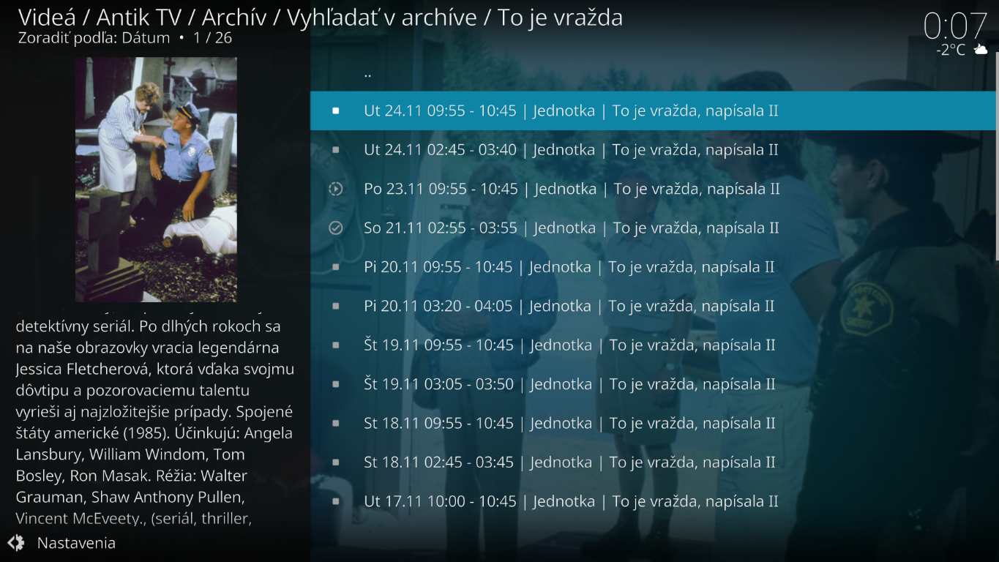
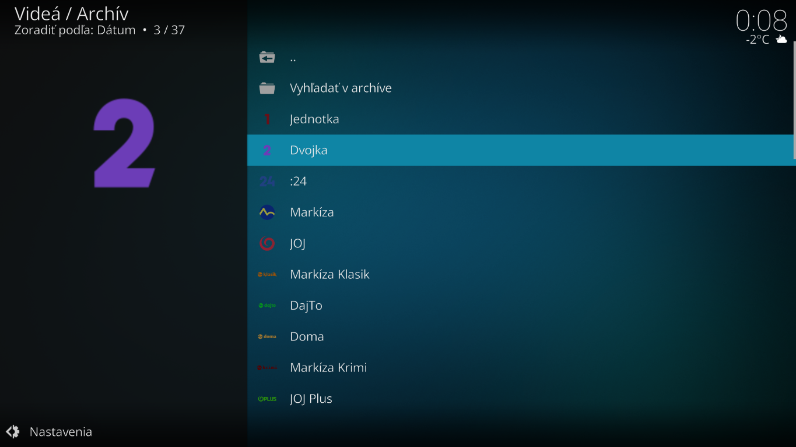
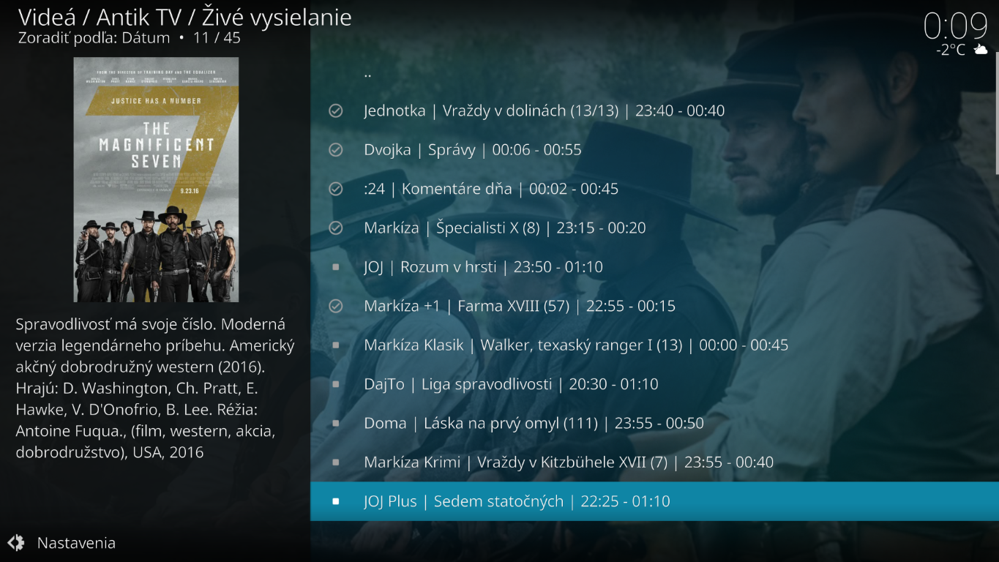

# Antik TV for Kodi

An independent, personal fork of the Antik TV Kodi add-on for Slovakia and
the Czech Republic. It builds on the original add-on with archive search,
programme artwork, station logos and other improvements that suit my own
setup.

This project was created primarily for my personal needs and is shared in the
hope that it might be useful or inspiring to others. I do not plan to publish
it in a Kodi add-on repository.

> **Unofficial project:** This add-on is not an official Antik product and is
> not developed, endorsed or supported by Antik.

## Status and compatibility

The fork has only been tested on my own Windows PC with Kodi 22. It has not
been thoroughly tested on other devices, operating systems or Kodi versions.
The code needs further review and testing, and may need adjustments, before
wider deployment. Use it at your own discretion.

The add-on retains the original ID, `plugin.video.antik`. It cannot be installed
alongside the original as a separate add-on. Back up your existing add-on and
its settings before replacing or updating it. Disable automatic updates for
Antik TV in Kodi so that an update from another repository does not replace
this fork.

## What's new in this fork

- **Artwork:** Use original Antik-themed icons in the main menu and archive
  search, keep the fanart background while navigating, and fall back to it when
  programme artwork is unavailable. Archive programmes without a thumbnail
  use their station logo.
- **Archive search:** Search programme titles across visible channels and their
  configured archive retention. If retention is unknown, the search uses
  14 days. Results can also be requested through Kodi's JSON-RPC interface.
- **Programme artwork:** Display available Antik artwork in live TV, archive
  listings and search results, and include it in XMLTV exports. Artwork URLs
  are cached for 20 days; the first lookup or EPG generation can take longer.
- **Station logos:** Show local channel logos in Kodi and include them in M3U
  and XMLTV exports. A configured Picons server takes precedence.
- **IPTV Merge:** Provide the generated playlist and XMLTV guide as a source
  for the optional IPTV Merge add-on.
- **Archive downloads:** Send archive programmes from the context menu to my
  separate `script.stream.saver` add-on for downloading.
- **Archive playback:** Estimate where a programme begins by subtracting its
  EPG duration from the stream duration. This is only an estimate: it may
  leave advertisements or skip content, including for short programmes. It
  does not remove ad breaks or affect downloads. The option can be disabled
  in the add-on settings; Kodi's resume request takes precedence.
- **Remote playback metadata:** Pass available programme details and artwork
  to the player when starting a programme from archive search results.

## Screenshots

Archive search results with programme information and artwork:



Archive channels with station logos:



Live TV with programme information and artwork:



## Installation

When a release is available, download its add-on ZIP from the
[Releases page](https://github.com/neradp/plugin.video.antik/releases) and
install it in Kodi through **Add-ons > Install from zip file**. Kodi may ask
you to allow installation from unknown sources.

Alternatively, download this repository, extract it if necessary, and copy
the add-on files into a folder named `plugin.video.antik` in Kodi's add-ons
directory. Restart Kodi if necessary.

Before replacing an existing installation, back up the original add-on and its
settings, and disable automatic updates for Antik TV in its Kodi add-on
information screen. Because the fork uses the same add-on ID, Kodi can reuse
the existing configuration; there is no need to delete it. Enable the add-on
and check its settings. If needed, enter your Antik credentials and select the
service region.

The fork's version (`0.0.3`) is lower than the original add-on's `1.2.0`.
Kodi may treat replacing the original as a downgrade; check its
prompts and the installed version.

### Requirements and optional components

- An Antik TV account and the Kodi dependencies listed in `addon.xml` are
  required. Playback may also require Widevine; the add-on settings provide
  access to InputStream Helper.
- **ImageMagick** is optional and is only needed to download and convert
  local station logos using the updater described below.
- **`script.stream.saver`** is my separate, unofficial Kodi add-on for recording
  streams. It is optional and only needed to download archive programmes
  through the context menu. It does not have its own repository yet.
- **IPTV Simple Client** is optional and can use the generated M3U playlist
  and XMLTV guide.
- **IPTV Merge** is optional and can use the generated playlist and XMLTV guide
  as one of its input sources.

### Station logos

Downloaded station logo files are not included in the repository or intended
to be bundled in release ZIPs. They are Antik TV station logos downloaded by
the user from publicly accessible URLs supplied by the service. To generate
them locally, install ImageMagick and use **Update station logos** in the
add-on settings.
The updater downloads SVGs and converts them to PNG. It looks for `magick` in
`PATH` or `magick.exe` in the `ImageMagick` directory under `ProgramFiles`.
The updater is intended for Windows; ImageMagick is not needed for the add-on's
other features.

When a local logo is missing, channel lists use the default image and IPTV
exports fall back to Antik's logo URL when available. Regenerate the playlist
and XMLTV after updating logos. Local logo paths refer to the device where they
were generated; use a Picons server if the files need to be shared with
another device.

## Remote archive search

The add-on uses Kodi's existing JSON-RPC interface; it does not run a separate
web server. Enable Kodi's HTTP remote control and use a `Files.GetDirectory`
request with a URL-encoded query:

```json
{
  "jsonrpc": "2.0",
  "id": 1,
  "method": "Files.GetDirectory",
  "params": {
    "directory": "plugin://plugin.video.antik/?action=search_archive&query=Example",
    "media": "video",
    "properties": ["title", "plot", "genre", "file"]
  }
}
```

Use the `file` from a result with `Player.Open` to start it in Kodi. Available
programme metadata is passed to the player. Configure authentication for Kodi's
HTTP interface and avoid exposing it directly to the internet.

## ČSFD userscript

An optional browser userscript can search the Antik archive from ČSFD film and
series pages and start a selected broadcast in Kodi. See [USERSCRIPT.md](USERSCRIPT.md)
for installation, configuration and a screenshot.

## Service content and rights

The repository does not include TV streams, archive recordings, downloaded
station logo files or standalone programme artwork obtained from Antik. The
screenshots illustrate the interface and may show third-party logos and artwork.
The add-on accesses service content and artwork when used with an Antik TV
account; station logo files are downloaded only when the user runs the updater.

Antik TV names, logos, programme artwork and content belong to their respective
rights holders. Public availability or an account subscription does not by
itself grant permission to redistribute them. Users are responsible for
complying with applicable service terms and rights.

## Privacy

Do not share your Kodi profile or `userdata/addon_data/plugin.video.antik`:
they may contain credentials, session tokens and other private data. Be
careful when sharing logs or configuration files as well.

## Tests

The tests use Python's standard `unittest` runner and mock Kodi APIs:

```text
python -m unittest discover -s tests -p "test_*.py"
```

Passing these tests does not replace testing playback and integration in Kodi.

## Changelog

See [CHANGELOG.md](CHANGELOG.md) for the fork's release history.

## Creating a release

On `master`, set the version in `addon.xml` and add a matching dated entry to
`CHANGELOG.md`, using the heading `## vX.Y.Z - YYYY-MM-DD`. Commit and push
those changes, then create and push a tag such as `v0.0.1`. The release workflow
checks the tag, version and changelog, then publishes a GitHub release with a
Kodi-installable ZIP. Its description comes from that changelog entry.

The tag must point to a commit on `master`. The ZIP contains the add-on files,
license and IPTV Merge integration configuration, but no tests, documentation
or locally generated station logos.

## Credits

This fork is based on [waladir/plugin.video.antik](https://github.com/waladir/plugin.video.antik).
Many thanks to **waladir** for creating the original add-on and providing the
foundation for this project.

The original community support thread is on
[XBMC-Kodi.cz](https://www.xbmc-kodi.cz/prispevek-antik-tv--13396).

## License

GPL-3.0; see [LICENSE.txt](LICENSE.txt).
