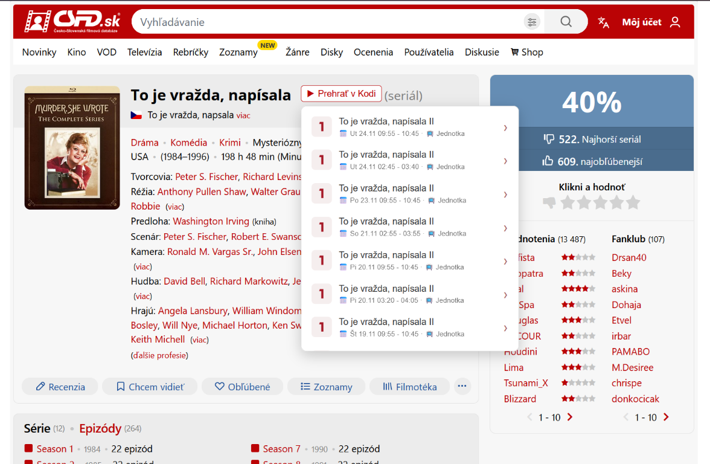

# ČSFD to Antik archive userscript

This optional browser userscript connects ČSFD film and series pages to the
archive search in this Antik TV add-on. It searches only the Antik archive;
it does not search other Kodi add-ons. The userscript is distributed separately
from the add-on and is not included in its release ZIP.

## What it does

When you open a film or series page on `csfd.cz` or `csfd.sk`, the script
searches the archive through Kodi. If it finds matching broadcasts, the
**Prehrať v Kodi** button opens a menu with the programme, broadcast time and
station. Station logos are shown when available. Choose a broadcast to start
playback in Kodi.

For films, the script checks the title and production year. For series, it
matches the title and programme information without requiring a year. Search
results depend on available EPG information, visible channels and archive
retention, so matches are not guaranteed. If there are search results but no
confirmed match, the menu can open the archive search in Kodi instead.

Search or playback errors are shown in the interface; a failed search can be
retried from the menu.

## Requirements

- The Antik TV fork installed and configured in Kodi, with a working Antik TV
  account and archive access.
- Kodi's HTTP remote control enabled under **Settings > Services > Control**.
  If the browser runs on another device, Kodi must also allow remote control
  from other systems.
- A browser with [Tampermonkey](https://www.tampermonkey.net/) or a compatible
  userscript manager.

## Installation

1. Install and enable your userscript manager.
2. Open the [userscript installation link](https://gist.githubusercontent.com/neradp/7db1bbf0442e4bbe3937e0a344e02e8b/raw/csfd-antik-archive.user.js)
   and confirm the installation in the userscript manager.
3. Open a film or series page on ČSFD and configure the Kodi connection as
   described below.

The script contains update and download URLs pointing to its public
[GitHub Gist](https://gist.github.com/neradp/7db1bbf0442e4bbe3937e0a344e02e8b).
Automatic updates depend on the userscript manager and its update settings.

## Configure Kodi

1. On a ČSFD film or series page, click the Tampermonkey browser icon and
   select **Nastavenie Kodi**.
2. Enter the Kodi JSON-RPC URL. The default is
   `http://localhost:8080/jsonrpc` when Kodi runs on the same computer. For
   another device, use its address and Kodi's configured HTTP port, for example
   `http://192.168.1.100:8080/jsonrpc`.
3. Enter the username and password configured for Kodi's HTTP interface. The
   password is visible while typing. The script then retries the search.

The userscript manager stores these settings; they are not published in the
Gist. When changing the settings, enter the password again. Cancelling any
prompt leaves the previous settings unchanged.

The script requests `@connect *` so the Kodi address can be configured.
Your userscript manager may ask for permission to contact the chosen host.
Use only a Kodi address you trust. HTTP sends credentials unencrypted; avoid
exposing Kodi's HTTP interface directly to the internet.

## Notes

This is an unofficial personal userscript, not a product of Antik or ČSFD.
The screenshot contains ČSFD content; names, logos and artwork belong to their
respective rights holders.
